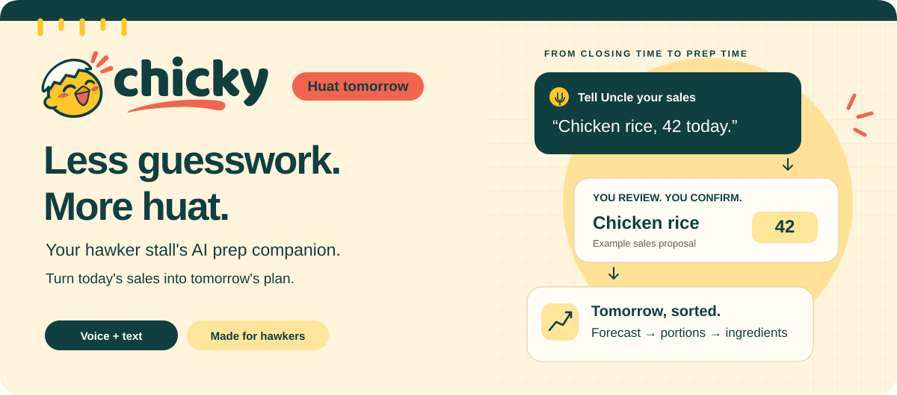
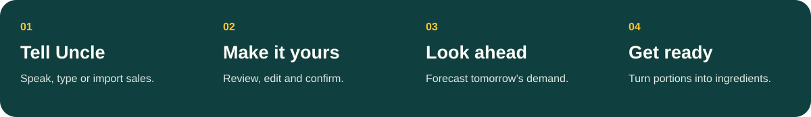
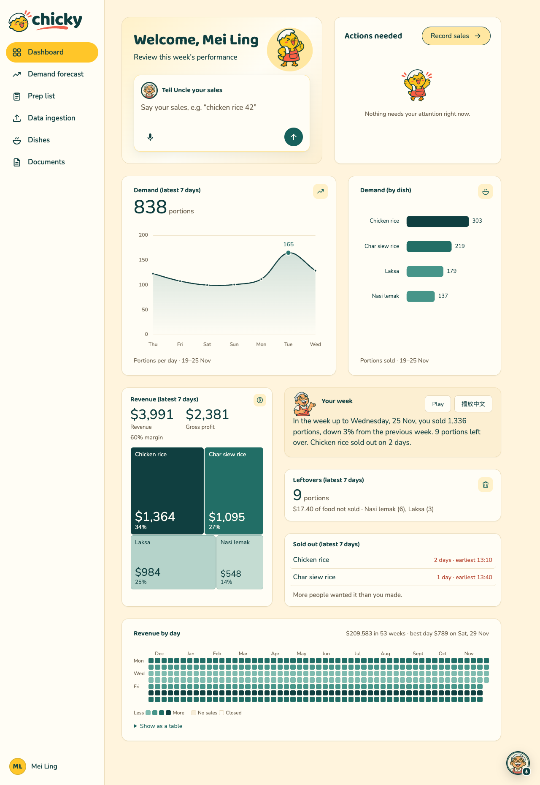
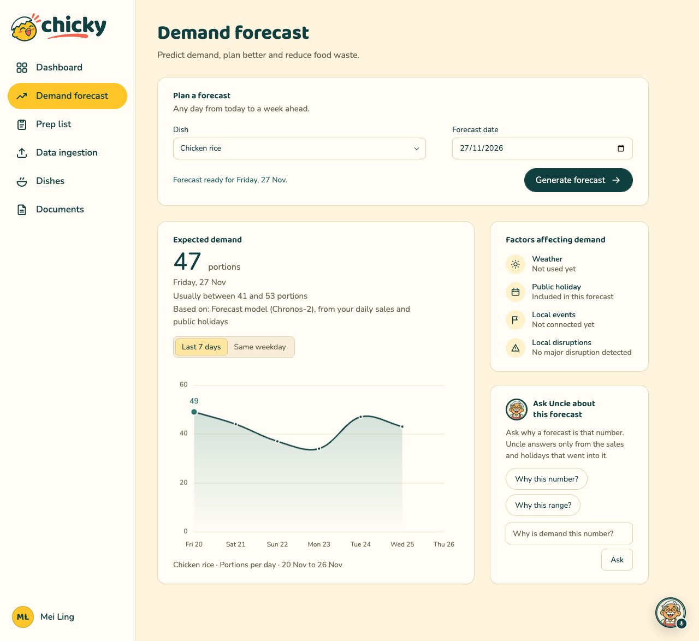
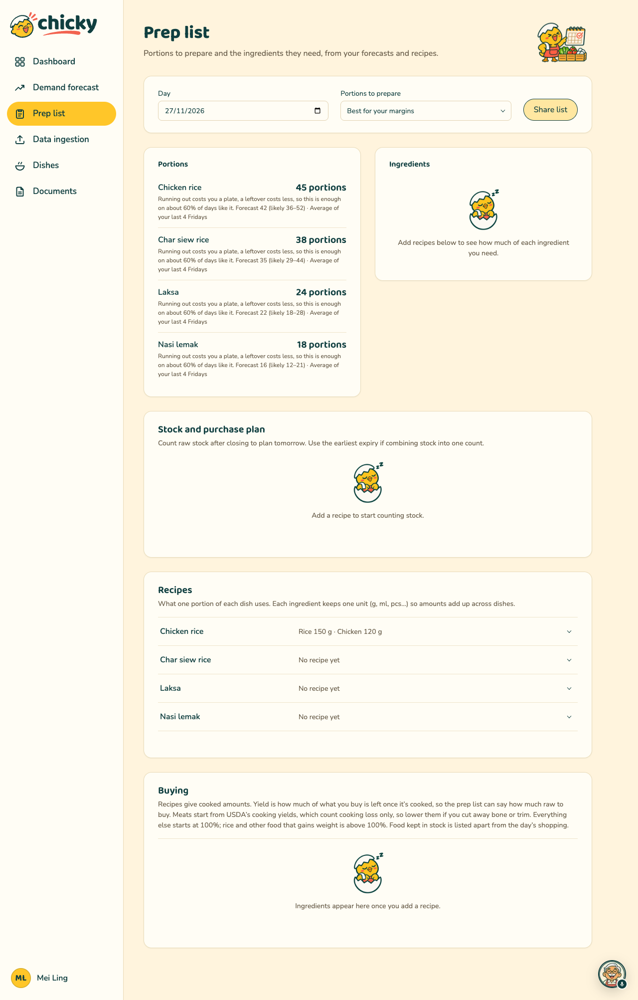
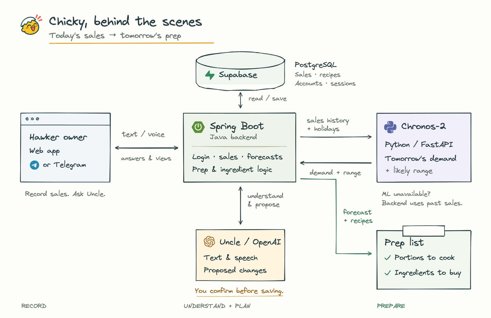

<p align="center">
  <a href="https://chicky-app.duckdns.org">
    
  </a>
</p>

<h1 align="center">Chicky · Huat tomorrow</h1>

<p align="center">
  <strong>Close today's shift. Get tomorrow's prep sorted.</strong><br>
  An AI companion for hawker stall owners, from spoken sales to demand forecasts and ingredient prep lists.
</p>

<p align="center">
  <a href="https://chicky-app.duckdns.org"><strong>Open Chicky ↗</strong></a> ·
  <a href="https://chicky-zeta.vercel.app">Backup site</a> ·
  <a href="#a-five-minute-tour-for-judges">Judge's tour</a> ·
  <a href="#run-locally">Run locally</a>
</p>

<p align="center">
  <a href="https://github.com/OccupiedPorcupine/chicky-hackathon/actions/workflows/ci.yml"></a>
  
  
  
</p>

## Tomorrow's prep starts with today's sales

After a long shift, a stall owner still has to answer: **How much should I cook
tomorrow, and what do I need to buy?** Too much preparation leaves food unsold;
too little means turning customers away. Sales notes, supplier documents and
recipes often sit in different places.

Chicky brings that work into one flow. Tell **Uncle**, the assistant, what you
sold, check his proposal, and confirm it. Chicky uses sales history to forecast
demand, then combines planned portions with recipes and yields to make an
ingredient prep list. The owner stays in control of changes.



## A five-minute tour for judges

**Start with the [live app](https://chicky-app.duckdns.org), or use the
[backup](https://chicky-zeta.vercel.app).** Create a dedicated account for your
walkthrough. For a populated, reproducible demo with fictional sales, follow the
[local setup](#run-locally) below; its public demo credentials are for local use.

| Step | Try this | What to look for |
| --- | --- | --- |
| **1 · Close the shift** | On the Dashboard, tell Uncle `today char siew rice 30` using a dish in your account. | A proposed sale you can inspect and edit before saving. |
| **2 · Stay in control** | Change the quantity to 32 and confirm. Make another proposal and cancel it. | Only the confirmed change appears in sales. |
| **3 · Plan tomorrow** | Generate a demand forecast, then ask `why this number?`. | The forecast method, likely range and actual inputs behind the explanation. |
| **4 · Get ready** | Open the Prep list. | Portions become ingredient quantities through recipes and yields. |
| **5 · Ask Uncle** | Ask about an uploaded supplier document, or record a mixed-language sale. | Cited document answers and voice input when the OpenAI integration is configured. |

For the live closing-shift voice experience, including a spoken correction and
readback before confirmation, see the [voice demo and rehearsal guide](docs/realtime-demo.md).
The [acceptance checklist](docs/hackathon-readiness.md) tracks the full manual demo pass.
Deployment addresses are configured in this repository; check availability and
integrations before presenting. A published container image does not establish
that a running deployment is current.

## A look inside

| Your stall at a glance | Tomorrow's demand | From portions to ingredients |
| :---: | :---: | :---: |
| [](frontend/design/screenshots/dashboard.png) | [](frontend/design/screenshots/forecast.png) | [](frontend/design/screenshots/prep.png) |

*Repository reference screenshots with illustrative data; click to enlarge.*

## What makes Chicky useful

| Capability | Built for the stall |
| --- | --- |
| **Uncle, on voice or text** | Record sales in English, Singlish, Mandarin or mixed speech, with editable proposals before confirmation. |
| **Demand forecasting** | Chronos-2 forecasts from sales history and public holidays, with a historical baseline when history is short or ML is unavailable. |
| **Practical prep lists** | Connect dish portions to recipes, ingredient yields, prices and costs, so a forecast becomes a preparation decision. |
| **Answers from your documents** | Ask about uploaded supplier information and stall notes, with citations when the document integration is configured. |
| **Web + Telegram** | Use the responsive web app at the stall, or the configured Telegram integration for text, voice and reminders. |
| **Designed for the owner** | Phone-friendly pages, guided tours and explicit review of assistant-proposed changes. |

## Architecture



[Editable Excalidraw](docs/diagrams/chicky-backend.excalidraw) ·
[SVG for slides and video](docs/diagrams/chicky-backend.svg) ·
[HTML preview](docs/diagrams/chicky-backend.html)

The Spring Boot backend stores sales and recipes, calls Uncle for text and voice
assistance, and turns demand forecasts into portions and ingredients to buy.
Assistant changes require the owner's confirmation. Chronos-2 uses sales history
and public holidays; the backend falls back to a historical baseline when there
is too little history or the ML service is unavailable. The diagram shows
Supabase Postgres; local development defaults to in-memory H2.

- [Frontend](frontend/README.md): responsive pages, confirm cards and guided tours.
- [Backend](backend/README.md): authentication, sales, imports, documents, forecasts
  and assistant tools. Writes proposed by the assistant require confirmation.
- [ML](ml/README.md): forecasting API, benchmarks and prep-policy simulations.
- [Database](database/README.md): Supabase configuration and migration guidance.
- [Assistant evaluation](assistant-eval/README.md): repeatable text, document and
  recorded-audio evaluations; [report](assistant-eval/REPORT.md) lists limitations.
- [Deployment](deploy/README.md): hosting, container releases and setup checks.


## Run locally

Requires Java 21+, Node.js and Python 3. The frontend has no build step; the
backend includes a Maven wrapper.

1. Start the backend from `backend/`:

   ```sh
   cd backend
   ./mvnw spring-boot:run
   ```

   Without a `backend/.env`, this uses an in-memory H2 database, which is cleared
   on restart. An existing `.env` may select Supabase: check it before seeding
   data. See [backend setup](backend/README.md) and the optional settings in
   [backend/.env.example](backend/.env.example).

2. In a second terminal, from the repository root:

   ```sh
   node frontend/server.mjs
   ```

3. For a local demo, add `ASSISTANT_PROVIDER=offline` to `backend/.env` and restart
   the backend. This supports typed examples without an API key; voice input and
   generated speech require the OpenAI integration. Google sign-in is optional.

4. With the backend running against the intended local database, populate an
   example account:

   ```sh
   python3 scripts/seed_demo_data.py
   ```

   Sign in at [localhost:5500](http://localhost:5500) with
   `demo@chicky.test` / `chicky-demo-password`. These are public demo credentials;
   use them only for local development. The script creates five dishes, recipes,
   prices and 120 days of invented sales, and can be rerun to fill missing data.

The ML service is optional for this quick start: forecasts fall back to the
historical baseline when it is unavailable. To demonstrate Chronos-2 forecasts,
use a deployed Chicky app with ML configured, or run the ML service locally using
[ML setup](ml/README.md) and [deployment instructions](deploy/README.md). The
deployed ML service is private; a local backend cannot call it through the public
website.


## Verification

```sh
# Backend tests, including API and authorization checks; isolated test database
cd backend
./mvnw verify
```

ML checks and their pinned Python environment are described in
[ml/README.md](ml/README.md); browser checks are in
[frontend/README.md](frontend/README.md). GitHub Actions runs the repository's
automated checks. Real microphone permissions, email delivery, Telegram and
home-screen behavior also need the [manual acceptance pass](docs/hackathon-readiness.md).

The forecast uses sales history and public holidays. Weather-based dashboard
insights are separate from the forecasting model. Simulated improvements are
research results, not measured gains from real hawker stalls.
