# Chicky design language

The Account page's Sign-in duration card uses shared fields and form actions. Users can save
idle and absolute session limits or restore the defaults; changes apply on their next sign-in.

How Chicky looks and why, so new screens match the existing ones. If you are adding UI, read
[the checklist](#checklist-for-new-ui) at the end first.

| Where | What |
| --- | --- |
| [css/base.css](css/base.css) | Design tokens and every shared component. Load it first on every page. |
| [js/chart-theme.js](js/chart-theme.js) | Chart.js colours and fonts, read from the tokens. |
| [js/app-shell.js](js/app-shell.js) | Navigation behaviour shared by every signed-in page: the sidebar, the phone menu sheet and the account menu. |
| [js/motion.js](js/motion.js) | Shared behaviour: the primary-button fill, smooth scrolling (Lenis), the pointer light on `[data-spotlight]` cards, the loading marker. |
| [design/styleguide.html](design/styleguide.html) | Live reference of all tokens and components. Open it with the dev server running. |
| [design/screenshots/](design/screenshots/) | Reference screenshots of every page, regenerated by [design/capture-screenshots.cjs](design/capture-screenshots.cjs). |

Page stylesheets (`dashboard.css`, `forecast.css`, `data.css`, `styles.css`) contain **layout
only**. A colour, font size, radius or shadow that isn't a token is a smell: add or reuse a token
in `base.css` instead.

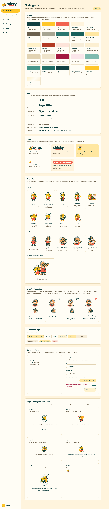

## Character

Chicky is a planning tool for hawker and F&B owners. It should feel calm, warm and a little
hand-made, not like an analytics dashboard. The look comes from the brand asset sheet
([docs/brand/asset-sheet.png](../docs/brand/asset-sheet.png)): Chicky the chick, and five colours.

- **Warm, quiet surfaces.** A cream page (`--page`, Cream), shell cards with a soft shadow, and
  one gradient: the sidebar (and the top bar on phones), which runs from soft yolk to cream.
  Cream is the page and Shell the cards, not the other way round: the lighter card lifts off the
  warmer page the way white cards did on the old cream page, and a page of cream cards reads
  heavy and yellow.
- **Ink, with yolk and coral as supporting colours.** Ink carries text, icons and recorded data.
  The ink-green `--accent` family marks what is interactive or predicted: focus rings, links,
  primary buttons, the dashed forecast line. **Yolk** fills (always with ink text) mark what is
  selected or hovered. **Coral** is for callouts only: needs-attention tags such as "New dish",
  and the "Huat tomorrow" tagline pill. Neither yolk nor coral is ever small text (see
  [Colour](#colour)). Use the status colours only for status.
- **A rounded voice.** Baloo 2 (`--font-display`) is the heavy, rounded face of the wordmark and
  headings, as on the sheet. Nunito (`--font-ui`) carries everything people read: body text,
  controls, tables, charts and the assistant. Weight belongs to the display face: headings are
  Baloo 2 at 600 (page titles 700, the wordmark 800), and running text stays at Nunito 400. Don't
  bold body text for emphasis; use a heading, size or colour.
- **Plain words.** Sentence case, short labels, no jargon (see [Writing](#writing)).

## Pages

Every signed-in page has the same skeleton, and it is the dashboard's:

```
body.app-shell
  a.skip-link      "Skip to main content", first Tab stop
  header.topbar    Chicky logo (a.brand) · details.navigation (nav.menu-panel) · details.account-menu
  main.page        max 1180px wide, centred, tabindex="-1" so the skip link can land on it
    .page-heading  h1 + p.lede (optional tag or action on the right)
    content        cards, 24px apart
assistant bubble   added by js/assistant.js, bottom right
```

The same markup is the **left sidebar** at 1100px and wider (248px, full height, the yolk-to-cream gradient, the
menu always open) and a **top bar with a Menu sheet** below that. One set of links serves both, so the guided
tour finds the same targets either way. The page grid is `body.app-shell { grid-template-columns: var(--sidebar-w) 1fr }`,
so nothing fixed or sticky ever covers the content: the sidebar is a column, the top bar is in the flow, and
`.page` leaves 104px at the bottom for the assistant bubble.

| Dashboard | Demand forecast |
| --- | --- |
| 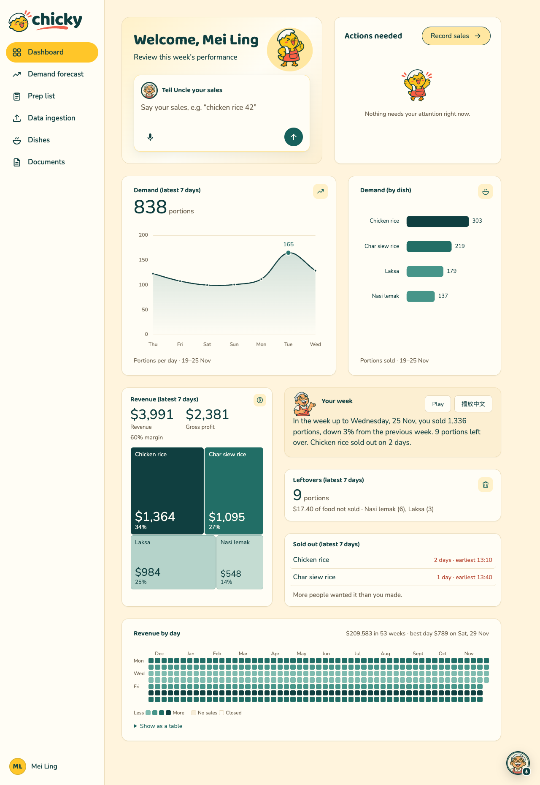 | 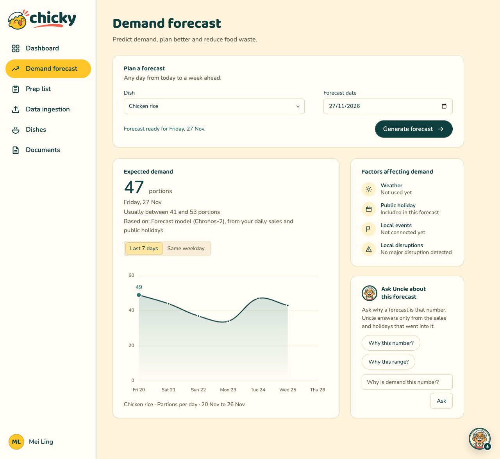 |

| Data ingestion | Sign in |
| --- | --- |
| 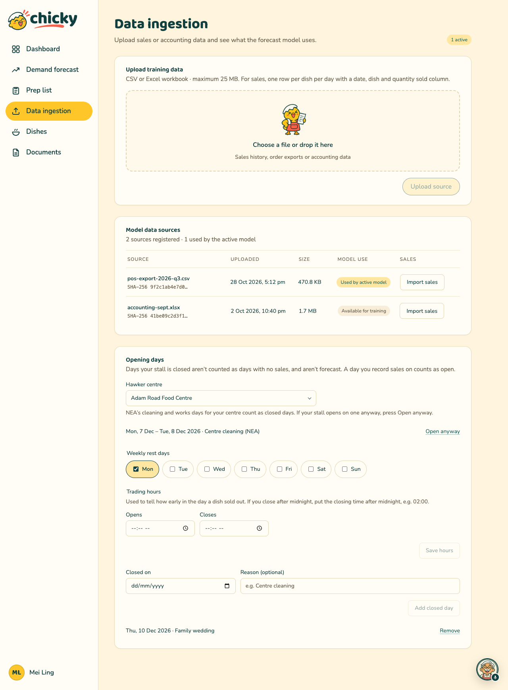 | 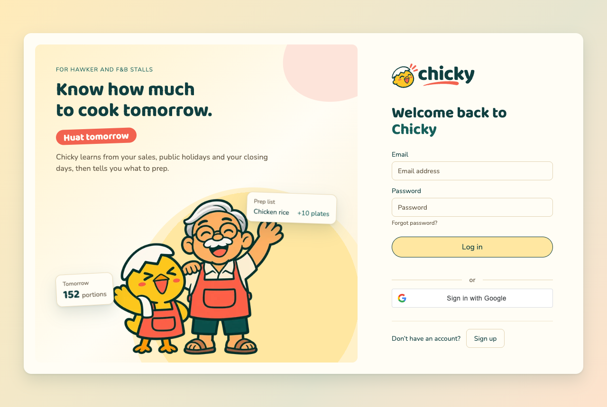 |

The sign-in page (and its sign-up, forgot and reset views, all in `index.html`) shares the colours, type, cards and buttons but has no navigation and no smooth scrolling: one centred card on the soft brand gradient. Its
left half is a decorative picture of what Chicky does: a sales line that draws itself, the dashed
green forecast continuing it, and two cards (tomorrow's forecast, a prep-list nudge) floating over it.

### Getting around

**Every page must be reachable from every other page.** The rule:

- **Top-level pages** (Dashboard, Demand forecast, Prep list, Data ingestion, Dishes, Documents) are listed in the sidebar
  (the Menu button on a phone) on **every** signed-in page, in that order, with those labels and these inline-SVG
  icons (`.nav-icon`, `currentColor`). The current page is in the list too, with `aria-current="page"` (which draws the
  ink bar and yolk tint); the others get `data-guide-id="nav-<page>"` so the guided tour can point at them. The markup is
  identical on every page apart from which link is current, so copy the header from `dashboard.html`.
- **Subpages** (a page that only makes sense inside another, such as one dish's history) don't go
  in the menu. Link to them from their parent page, and give them a way back: a "← Dashboard"
  style text link above the `h1`, naming the parent.
- **Account** lives in the avatar menu (the foot of the sidebar; top right on a phone): the user's name, email, a link
  to the Account page and Log out, which returns to the sign-in page. Account is not in the list, so no link is current
  there. Signing in lands on the Dashboard.
- The logo links to the Dashboard.

`js/app-shell.js` keeps the sidebar's menu open on wide screens and manages the `<details>` menus below that: one open
at a time, closed on an outside click or Escape. It also sets `.has-sidebar` on `<html>`.

```
Sign in ──► Dashboard ◄──► Demand forecast ◄──► Prep list ◄──► Data ingestion ◄──► Dishes ◄──► Documents
               ▲            (sidebar on every page links all six)                   ▲
               └──────────────────── avatar menu: Log out ──► Sign in
```

| Sidebar (1280px) | Menu sheet (phone) |
| --- | --- |
| 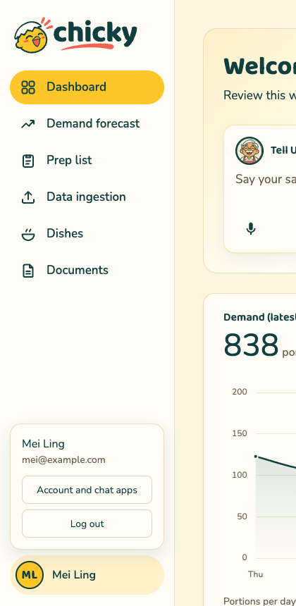 | 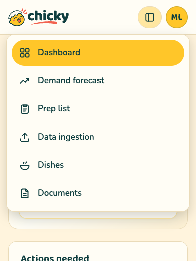 |

## Colour

All colours are tokens in `base.css`. Don't write hex values anywhere else: page stylesheets and
scripts use the tokens (`color-mix()` with a token is fine for a translucent shade).

**Brand colours**, from the asset sheet:

| Token | Value | Use for |
| --- | --- | --- |
| `--ink` | `#103f40` | Ink. Text, icons, recorded data in charts, the primary button's outline and fill |
| `--yolk` | `#ffc629` | Yolk. Fills and outlines only (hover outline on cards and secondary buttons), always with ink text. Never text |
| `--coral` | `#f26350` | Coral. Callout fills and large type only (the tagline pill). Never small text |
| `--cream` | `#fff4dd` | Cream. The page (`--page`) |
| `--shell` | `#fffdf5` | Shell. Cards, controls and menus (`--surface`), and text on ink or green fills |

**Derived tokens:**

| Token | Value | Use for |
| --- | --- | --- |
| `--muted` | `#6b604d` | Secondary text: ledes, captions, notes, placeholders. A warm taupe |
| `--subtle` | `#a7a592` | Decorative or switched-off icons. Never text (fails contrast) |
| `--accent` | `#2a766f` | Interactive marks: focus ring, selected outlines, predictions, icon fills, the tour's highlight ring. Not text |
| `--accent-strong` | `#17605b` | Accent **behind or as text**: user chat bubbles, send buttons, links, success text |
| `--accent-hover` | `= --ink` | Hover on `--accent-strong` fills |
| `--accent-soft` | `= --yolk-soft` `#ffe7a1` | Selected state (current menu item, active tag, rest-day toggle), the primary button at rest |
| `--accent-tint` | `= --yolk-tint` `#fff1c9` | Hover state on light surfaces, the chip behind a card's icon |
| `--coral-strong` | `#b23a24` | Coral as small text (via `--warning`) |
| `--neutral-soft` | `#f7edd8` | Neutral hover, inactive tags, segmented track, assistant bubbles |
| `--border` | `#e2d3b3` | Outlines of controls, menus and dashed drop zones |
| `--divider` | `#efe4cb` | Rules between rows, sections and chart gridlines |
| `--card-line` / `--sand-line` | `#eadbb9` / `#f1dfb8` | Outlines of cards and sections / of sand panels |
| `--sand-soft` | `#fcefd2` | Large warm panels ("Your week") |
| `--surface-muted` | `#fff9ec` | Inset areas inside a surface (drop zone, action rows, assistant confirm card) |
| `--error` / `--error-soft` | `#a3193f` / `#fbe6ea` | Error text / error message background. A crimson, so it never reads as coral |
| `--warning` / `--warning-soft` | `= --coral-strong` / `= --coral-soft` `#fde4da` | Needs-attention tags such as "New dish" and "Sold out by 13:10" |
| `--heat-1` … `--heat-4` | `#7fbbaf` `#479589` `#226e66` `= --ink` | One ink-green ramp for magnitude: the revenue heatmap, and the ranked bars and treemap tiles on the dashboard |
| `--header-gradient` / `--sidebar-gradient` | yolk-soft → yolk-tint → cream | The top bar on phones / the sidebar |
| `--wash-gradient` | yolk-tint → shell → sand-soft | The panel a page opens with: the dashboard's hero, the sign-in picture |
| `--focus-halo`, `--backdrop`, `--scrim` | translucent accent / ink | The ring round a focused field, behind a dialog, behind the tour's spotlight |

**Contrast (WCAG AA).** Every text colour passes 4.5:1 on every light fill it can sit on:

| Text | `--page` | `--surface` | `--surface-muted` | `--neutral-soft` | `--sand-soft` | `--accent-soft` | `--accent-tint` | `--warning-soft` | `--error-soft` |
| --- | --- | --- | --- | --- | --- | --- | --- | --- | --- |
| `--ink` | 10.6 | 11.4 | 11.1 | 10.0 | 10.2 | 9.5 | 10.3 | 9.6 | 9.7 |
| `--muted` | 5.6 | 6.1 | 5.9 | 5.3 | 5.4 | 5.0 | 5.5 | 5.1 | 5.2 |
| `--accent-strong` | 6.7 | 7.2 | 7.0 | 6.3 | 6.4 | 6.0 | 6.5 | 6.0 | 6.2 |
| `--error` | 6.9 | 7.4 | 7.2 | 6.5 | 6.7 | 6.2 | 6.7 | 6.2 | 6.4 |
| `--warning` | 5.5 | 5.9 | 5.7 | 5.1 | 5.2 | 4.9 | 5.3 | 4.9 | 5.0 |

Text on fills: Shell on ink (primary button filled, tooltips, the top treemap tile) 11.4:1; Shell on
`--accent-strong` 7.2:1; Shell on `--heat-3` 5.9:1; Shell on `--error` 7.5:1; ink on Yolk 7.4:1;
ink on the lightest treemap tile 7.3:1.

The rules that follow from the numbers:

- **Yolk and Coral are never text on Cream or Shell** (1.4:1 and 2.9–3.1:1). Use them as fills with
  ink text, or use `--coral-strong` for coral words.
- **Shell on Coral is 3.1:1**, so a coral pill's text must be large (24px, or 18.7px at 700 and
  over); smaller coral labels are `--warning-soft` with `--warning` text. Ink on Coral is 3.7:1, also
  large text only.
- **`--accent` is for marks, not words.** It is 4.4:1 or more on every light fill, comfortably above
  the 3:1 a focus ring or chart line needs; for text use `--accent-strong`.
- The heatmap's lightest step, `--heat-1`, is 2.14:1 on the card. That is fine for an ordinal ramp
  because every value is also in the "Show as a table" view and the tooltip.

## Type

| Token | Size | Use for |
| --- | --- | --- |
| `--text-number` | 40px | The one key figure in a card ("838 portions") |
| `--text-xl` | 32px | Page title (`h1`), one per page. 28px on phones |
| `--text-lg` | 20px | Section heading (`.section-heading h2`) |
| `--text-md` | 16px | Body text and card titles (`.card-title`) |
| `--text-sm` | 14px | Controls, labels, table cells, notes |
| `--text-xs` | 12px | Captions, metadata, table headers, tags |

- **`--font-display` (Baloo 2)** is for the wordmark, headings (`h1`–`h3`, card and section
  titles, the assistant panel's title) and the sign-in headline. Headings are 600, page titles 700,
  the wordmark 800.
- **`--font-ui` (Nunito)** is everything else: body text, controls, tables, charts, the assistant
  and the guided tour, at 400 (500 for small buttons in the assistant and tour).
- Neither face has Chinese, so both fall back to the system's CJK font (`--font-cjk`: PingFang SC,
  Hiragino Sans GB, Microsoft YaHei, Noto Sans CJK SC), which covers the dashboard's 播放中文.
- Load both on every page:
  `https://fonts.googleapis.com/css2?family=Baloo+2:wght@600..800&family=Nunito:wght@400..700&display=swap`
- Uppercase is only for table column headers (`--text-xs`, `letter-spacing: 0.08em`).

## Spacing, shape and depth

**Spacing** uses a 4px grid: 4, 8, 12, 16, 20, 24, 32, 40, 48. Common pairings:

- 4px between a label or title and its caption
- 8px between related controls (input + button, tags)
- 16–24px between cards in a column, and card padding (`20px 24px`)
- 32px between major blocks; 40px above a `.section`

**Radius**

| Token | Value | Use for |
| --- | --- | --- |
| `--radius-sm` | 6px | Things nested inside a control (segmented buttons, menu items) |
| `--radius-md` | 8px | Buttons, inputs, menus |
| `--radius-lg` | 12px | Cards, chat bubbles, drop zones, the tour bubble, cards inside the assistant |
| `--radius-xl` | 16px | Floating panels and the dashboard chat box |
| `--radius-pill` | 999px | Tags; circles use `50%` |

**Shadow**

| Token | Use for |
| --- | --- |
| `--shadow-card` | Cards sitting on the page: a soft, layered shadow tinted with `--ink` |
| `--shadow-card-hover` | A card under the pointer, and cards floating over a picture (sign-in page) |
| `--shadow-menu` | Drop-down menus |
| `--shadow-float` | Things floating above everything: assistant panel and bubble, tour bubble |

**Control height** is `--control-height` (40px) for every input, select and button.

**Breakpoints.** Pages switch to one column at `max-width: 760px` (the dashboard at 800px), and
data tables collapse further at 520px. Keep a 16px side gutter on phones and never scroll sideways.

| Dashboard | Demand forecast | Data ingestion |
| --- | --- | --- |
| 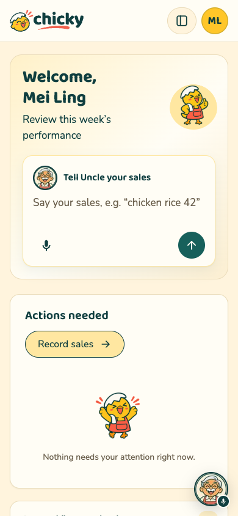 | 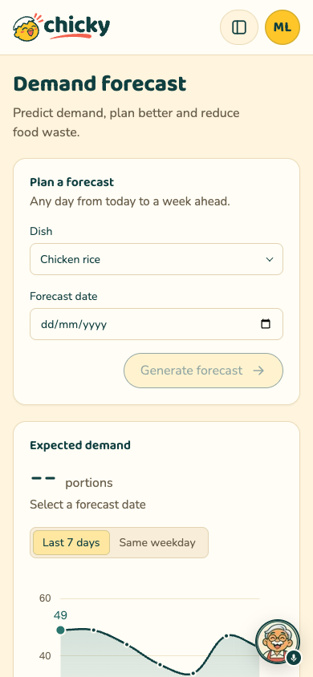 | 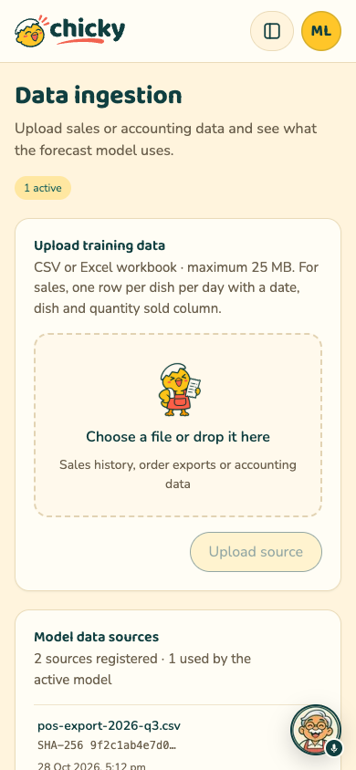 |

## Components

All of these are in `base.css` and shown in the style guide. Prefer them to new classes.

### Logo

The logo files are in `images/brand/` and come from the asset sheet (`docs/brand/asset-sheet.png`).

| File | What | Use for |
| --- | --- | --- |
| `logo-lockup.svg` | Chicky's head and the wordmark side by side | The header's brand link on every page, the sign-in card |
| `logo-mark.svg` | Chicky's head in the eggshell, with the burst | Anywhere 40px or bigger: home-screen icons, the link preview |
| `logo-mark-small.svg` | The head simplified, with no burst, cheeks or fine lines | 16–32px: the favicon (`images/icons/icon.svg` is a copy) |
| `wordmark.svg` | "chicky" in Baloo 2 ExtraBold, as outlines, on the Coral swoosh | Text-only placements |
| `huat-pill.svg` | The "HUAT TOMORROW" Coral pill | Optional, beside the wordmark or in a hero. Never on its own as the logo |
| `og-card.png` | 1200 × 630 link preview: Chicky and the wordmark on Cream | `og:image` in `index.html` |

- The brand link is `<a class="brand" href="dashboard.html"></a>`.
  The image's alt text names the link, so don't add a second "Chicky" in text.
- Keep the logo on Cream, Shell or Yolk-soft. Don't recolour it, add a shadow, or put it on Ink.
- Chicky is the brand; Uncle never stands in for the logo, and the logo isn't the user's avatar.
- `docs/brand/trace-logo.py` traces the mark and sets the wordmark again from the masters in
  `docs/brand/source/`. `design/render-icons.cjs` then builds the favicon, the home-screen icons
  and `og-card.png` (from `design/og-card.html`). Run both after changing the logo.

### Page heading

```html
<section class="page-heading">
  <div>
    <h1>Data ingestion</h1>
    <p class="lede">Upload sales or accounting data and review the sources available to the forecasting model.</p>
  </div>
  <span class="tag is-active">1 active</span>   <!-- optional -->
</section>
```

### Cards and headline figures

**Content lives in cards.** Anything the user reads or works with on a page (a chart, a form, a
table) goes in a `.card`, whether it spans the page or sits beside another card. Every card opens
the same way: a `.headline` with an `h2.card-title` and, optionally, a `.note` caption and one
`.number`.

```html
<section class="card" aria-labelledby="demand-heading">
  <div class="headline">
    <h2 id="demand-heading" class="card-title">Demand, latest 7 days</h2>
    <span class="number">838<span class="unit"> portions</span></span>
    <span class="note">All dishes · 24 Oct to 30 Oct</span>
  </div>
  …
</section>
```

One idea per card. A card has at most one `.number`. Leave 16px between the headline and the
card's content.

A `.section` (heading over a divider line, no card) is only for a page's closing area that isn't a
panel, such as the dashboard's "Actions needed" checklist. Don't put forms or tables in one.

### Buttons

| Class | Use for |
| --- | --- |
| `.primary-button` | The main action of the view, in the dashboard's "Record sales" look: a yolk pill with an ink outline that fills with ink from where the pointer entered (see [Motion](#motion)). **At most one visible at a time.** |
| `.secondary-button` | Other actions: Cancel, Sign up, Ask |
| `.text-button` | Low-emphasis inline actions: Remove, Log in (as a switch) |
| `.segmented` | Choosing between 2–4 views. Set `aria-pressed` on the buttons, not a class |

Add the arrow (`<span class="button-label">…</span><svg class="button-arrow">…`) to a primary button that moves the user forward ("Record sales", "Generate forecast"). A button that changes its label while working keeps the label inside `.button-label` and puts the same label back afterwards. Disabled buttons fade to 45% opacity and never show the fill. While a button is working, change its label to an
ellipsis form ("Generating…") and restore the **same** label afterwards.

### Forms

Every form behaves the same way. Upload on Data ingestion and Generate forecast on Demand forecast
are the two references.

```html
<section class="card" aria-labelledby="controls-heading">
  <div class="headline">
    <h2 id="controls-heading" class="card-title">Plan a forecast</h2>
    <span class="note">Any day from today to a week ahead.</span>
  </div>
  <form id="forecast-form">
    <div class="field">
      <label for="dish-select">Dish</label>
      <div class="select-wrap">            <!-- only for <select> -->
        <select id="dish-select" class="input">…</select>
      </div>
    </div>
    …
    <div class="form-actions">
      <p id="forecast-status" class="status-text" role="status" aria-live="polite"></p>
      <button class="primary-button" type="submit" disabled>Generate forecast</button>
    </div>
  </form>
</section>
```

1. **A real `<form>` inside a card**, handled on `submit` (not a button `click`), so Enter works.
2. **Fields stack** a short noun label ("Dish", "Forecast date", no colon) above a 40px `.input`.
   Every input, select and date picker gets `.input`. Buttons never sit inside a field row.
3. **One `.form-actions` row ends the form**: the status line on the left, buttons on the right,
   secondary actions (Remove) before the primary one.
4. **The primary button is disabled until the form can run** (a file is chosen; dishes have loaded
   and a date is picked). Don't leave it enabled only to reject the click with an error.
5. **While it runs**, the button reads "Uploading…" / "Generating…" and the status line says what
   is happening ("Working out expected demand…").
6. **When it finishes**, the status line says what happened, in `.is-success` ("Forecast ready for
   Saturday, 31 Oct.") or `.is-error` ("Couldn’t generate a forecast. Try again in a moment."),
   and the button gets its label back.
7. **Controls that aren't connected yet are disabled**, with a `title` saying so, rather than
   clickable and silent.

### Feedback

- **Inline status:** `<p class="status-text" role="status" aria-live="polite">`, in a form's
  `.form-actions` row (see [Forms](#forms)) or under the thing it is about, with `.is-error` or
  `.is-success`. Progress messages ("Signing in…") have no modifier. **Don't use `alert()`.**
- **Tags:** `.tag` (neutral), `.tag.is-active` (in use, selected), `.tag.is-warning` (needs a look).
- **Empty states:** `.empty-state`, one sentence saying what will appear here and how to get it
  ("Upload the first data source to make it available for training.").
- **Loading:** put the loading message in the element that will hold the data ("Loading sales…",
  `--` for a number). No spinners. Only say "Loading…" or "Checking…" while something is actually
  loading; a placeholder that isn't wired up says "Not connected yet".

### Charts

Charts use Chart.js through `js/chart-theme.js`. **A chart of one measure over days** (the dashboard's demand chart, the forecast page's
history) is `chickyChart.recordedChart(canvas, { labels, dates, values, unit, label, averageOf })`: the ink line with a faint accent wash,
a labelled peak, a dotted guide and a tooltip that gives the full date and how far above or below the average that day is. Put it in
`card graph chart-card` with `.chart > .chart-inner > canvas` and a `.chart-caption` under it; `chickyChart.pointer` and
`chickyChart.keyboard` (arrow keys, with a live region) are wired in for you. A page that also has predictions keeps them in text or
in the dashed `predictedLine` preset: never draw a prediction in the recorded style. Load it right after Chart.js, then spread a preset
into each dataset:

```js
datasets: [{ label: "Portions sold", data, ...chickyChart.recordedLine }]
```

| Preset | Meaning |
| --- | --- |
| `recordedLine` / `recordedBar` | Sales that happened: solid `--ink` |
| `predictedLine` | Model output: dashed `--accent` |

That split is the whole chart vocabulary: **ink is what happened, dashed green is what we expect.**
Gridlines are `--divider`, axis text is `--muted` in the UI font, and legends are off (say
what the chart shows in the card title instead). Give every `<canvas>` `role="img"` and an
`aria-label` describing the chart.

### Assistant and guided tour

The assistant widget ([css/assistant.css](css/assistant.css)) and tour ([css/guide.css](css/guide.css))
sit above every page and use `--font-ui`. They read the shared tokens with fallbacks, so they still
render if a page forgets `base.css`.

| Assistant with a confirm card | Guided tour |
| --- | --- |
| 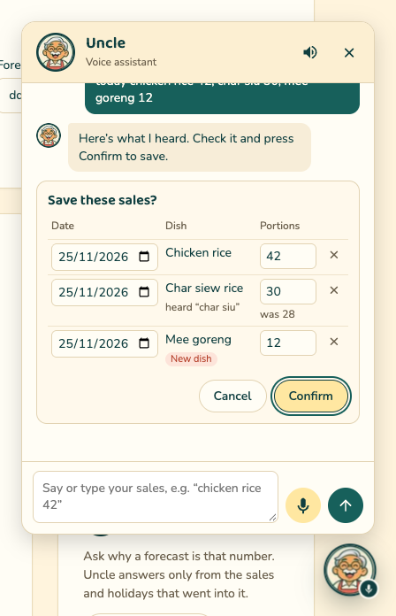 | 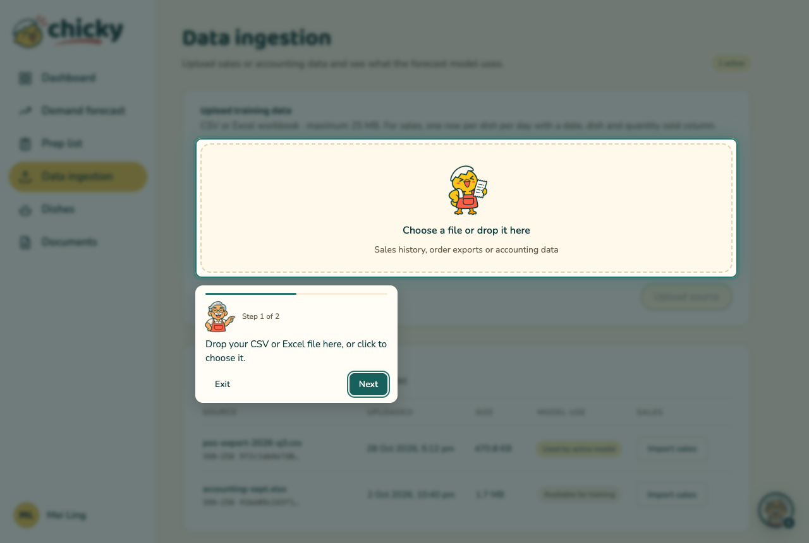 |

The tour is the app's most animated surface; see [Motion](#motion).

## Motion

Motion explains where something came from or went; it is never decoration. Everything eases out
(fast start, gentle stop) and stays short.

| Token | Value | Use for |
| --- | --- | --- |
| `--duration-fast` | 160ms | Menus opening, hover colour changes |
| `--move-duration` | 500ms | The primary button's fill |
| `--duration-base` | 300ms | Fades, the tour closing |
| `--duration-slow` | 450ms | The tour's spotlight moving between elements |
| `--ease-out` | `cubic-bezier(0.2, 0.8, 0.2, 1)` | Things appearing or arriving |
| `--ease-in-out` | `cubic-bezier(0.65, 0, 0.35, 1)` | Things moving from one place to another |
| `--ease-spring` | `cubic-bezier(0.34, 1.4, 0.64, 1)` | Small things popping in with a slight overshoot (send button, assistant bubble) |
| `--duration-enter` | 520ms | Sign-in page only: its picture and form rising in |

**Moving between pages is instant, and so is arriving.** There is no cross-fade or View Transition, no cards or rows
rising in, no figures counting up and no charts drawing in: a page's content is in its final place on the first frame,
and a figure is written as it is, so a number on screen is always the real number. Following a link goes straight to the
page, with no wait for an animation, and that holds for Back and Forward and for every `prefers-reduced-motion` setting.
Don't add `@view-transition`, a `view-transition-name`, an entrance animation or a delay before `location` changes.
Nothing shimmers or drifts on its own either. The sign-in page's picture is the one exception: it still draws itself in.
Animate only a response to something the user just did (below).

**Loading text** (a `.note`, `.status-text`, `.empty-state` or `.lede` starting with "Loading" or "Checking") gets
`.is-loading` from [js/motion.js](js/motion.js), which shows it in the muted colour, and a card's `--` figure waits in
`--subtle`. Still no spinners.

**Charts appear complete** ([js/chart-theme.js](js/chart-theme.js)): no draw-in, and a redraw shows new values at once. The
recorded line has a faint wash beneath it. The pointer and keyboard helpers there (`chickyChart.pointer`, `chickyChart.keyboard`)
mark the active point: they find it from anywhere on the chart (the whole canvas, not just the plot area), in the canvas's own
coordinates, so scrolling, zoom and device-pixel ratio can't throw them off.

**Feedback on interaction.**

| Element | Hover | Press |
| --- | --- | --- |
| Primary buttons | The cursor-origin fill (below) | Scale to 97% |
| Secondary buttons | Lift 1px with a soft shadow | Scale to 97% |
| Cards | None (a card that moves is a distraction; `[data-spotlight]` cards get a soft pointer light) | – |
| Fields | Border darkens to `--subtle` | Focus: `--accent` border and a soft `--focus-halo` |
| Menu items | Nudge 4px right | – |
| Avatar, assistant bubble, icon buttons | Grow slightly | Shrink slightly |

Cards never lift or move on hover.

**Things that open** grow out of where they came from: menus drop and unshrink from their corner,
the assistant panel grows from the bubble, the Record sales dialog rises with a blurred backdrop,
and a dismissed action slides right, fades and folds its row away (`chickyMotion.leave(element)`).
Status lines settle in when they report a result.

**The guided tour wins.** Smooth scrolling is off while a tour is running (`.guide-active`): the tour measures where things
are and scrolls by itself.

Load `js/motion.js` on every page, after `base.css` and before the page's own script. Signed-in pages also load Lenis (pinned, with an integrity hash; copy the tag from `dashboard.html`) in the `<head>`. GSAP is no longer used anywhere.

Load `js/motion.js` on every page, after `base.css` and before the page's own script. Signed-in pages also load Lenis (pinned, with an integrity hash; copy the tag from `dashboard.html`) in the `<head>`. GSAP is no longer used anywhere.

**Cursor-origin fill** (every `.primary-button`, or anything marked `data-cursor-fill`; the look is in `css/base.css`, the
behaviour is one delegated listener in [js/motion.js](js/motion.js)): on hover an ink circle grows from where the pointer
entered until it covers the button, and shrinks back to that spot when the pointer leaves; keyboard focus (`:focus-visible`)
and a touch press grow it from the centre. The button's size never changes (the circle is clipped inside it) and the focus ring
stays. It is only a preview: nothing is activated by hover or focus, and a disabled button never shows it. With reduced motion the
filled state just appears. Because the listener is on the document, a primary button added later (a dialog, a row) gets it for free.
Secondary and destructive buttons keep their plain look on purpose, so the fill always means "the main action".

**Smooth scrolling** ([js/motion.js](js/motion.js), Lenis 1.3.27, one shared set-up, one instance, one frame loop): every signed-in
page loads Lenis and `motion.js` starts it. It only eases a mouse wheel on a desktop. Touch screens, reduced motion, a running guided
tour and a page where the library did not load all keep the browser's own scrolling. Dialogs, the assistant panel, the tour layer,
tables, text areas and menus scroll natively (`allowNestedScroll` and `prevent`), anchor links and keyboard scrolling work through
the browser's position, and it pauses while a modal dialog is open. The sign-in page does not load it, because Lenis switches off
pointer events on iframes and Google's sign-in button is one. Don't add a second smooth-scroll set-up to a page.

**Menus** fade and drop 4px into place.

**The guided tour** ([js/guide.js](js/guide.js)) moves through a sequence of states:

1. **Dim in.** The shade fades in while blurring and desaturating the page behind it, and the
   spotlight closes in from the edges of the screen onto the first element.
2. **Land.** The ring around the spotlight ripples twice to draw the eye. The bubble rises in with
   the step's text, and the progress bar fills to the current step.
3. **Glide.** On Next or Back, the spotlight and bubble glide together to the next element, following
   the page as it smooth-scrolls. The bubble picks its side from where it will end up, so it never
   flips halfway through.
4. **Leave.** When the next step is on another page, the bubble fades but the spotlight and ring stay
   exactly where they are. This also happens if the user clicks the highlighted link themselves.
5. **Arrive and morph.** The new page's first frame has the dim, blur and spotlight in the same
   place the last page left them, so the overlay never cuts between pages.
   The spotlight then morphs from there onto the next element. Back across pages works the same way.
6. **Exit.** On Exit, Done or Escape, the shade fades and un-blurs back to the page.

| Closing in | Landed | Leaving the page |
| --- | --- | --- |
| 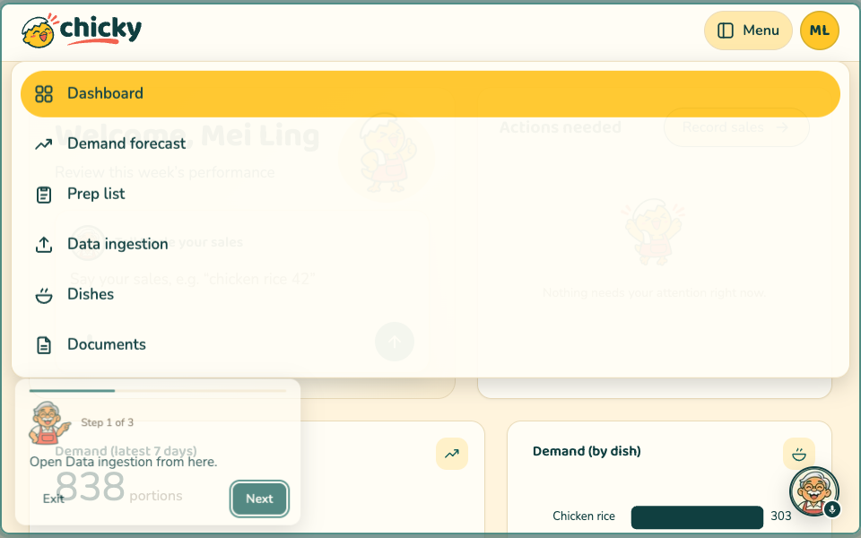 | 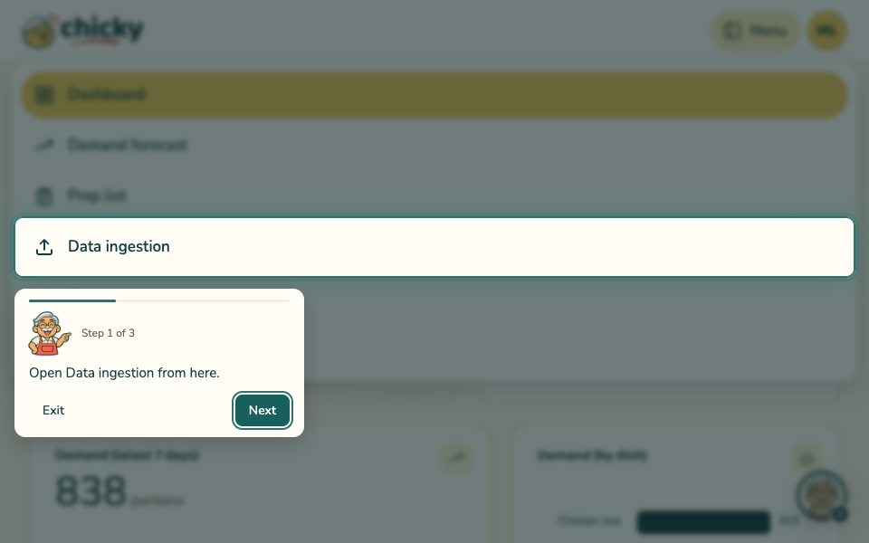 | 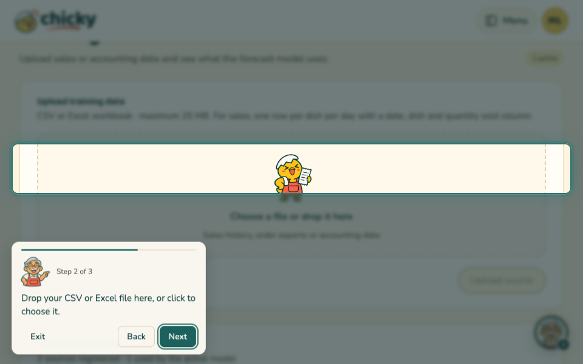 |

| Arriving: same spotlight, new page underneath | Morphing onto the next element | Arrived |
| --- | --- | --- |
| 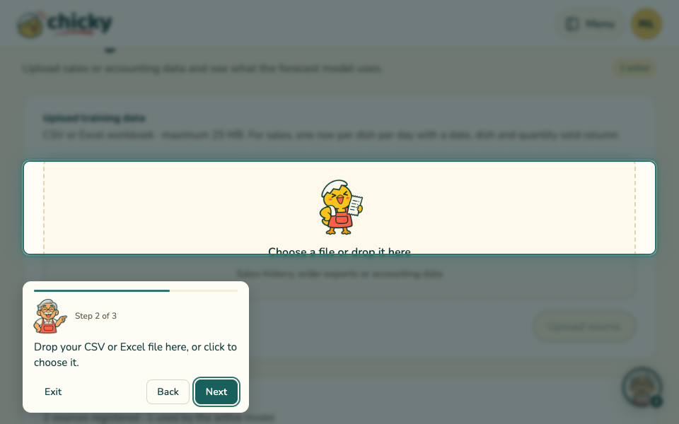 |  | 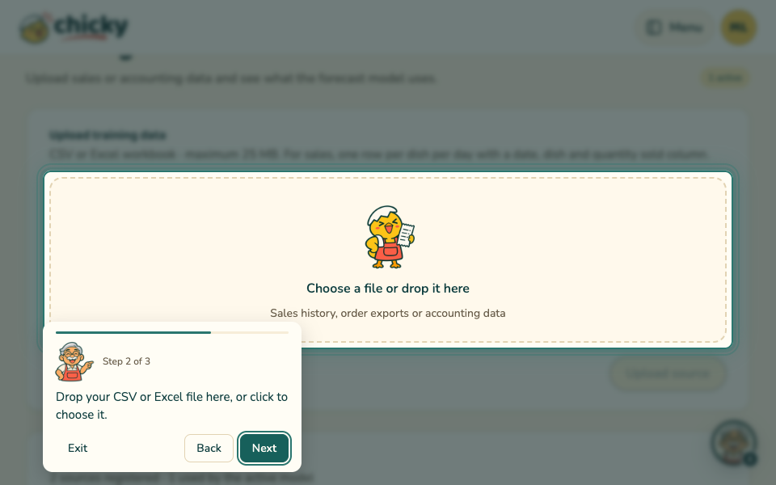 |

| Gliding to the next step on the same page |
| --- |
| 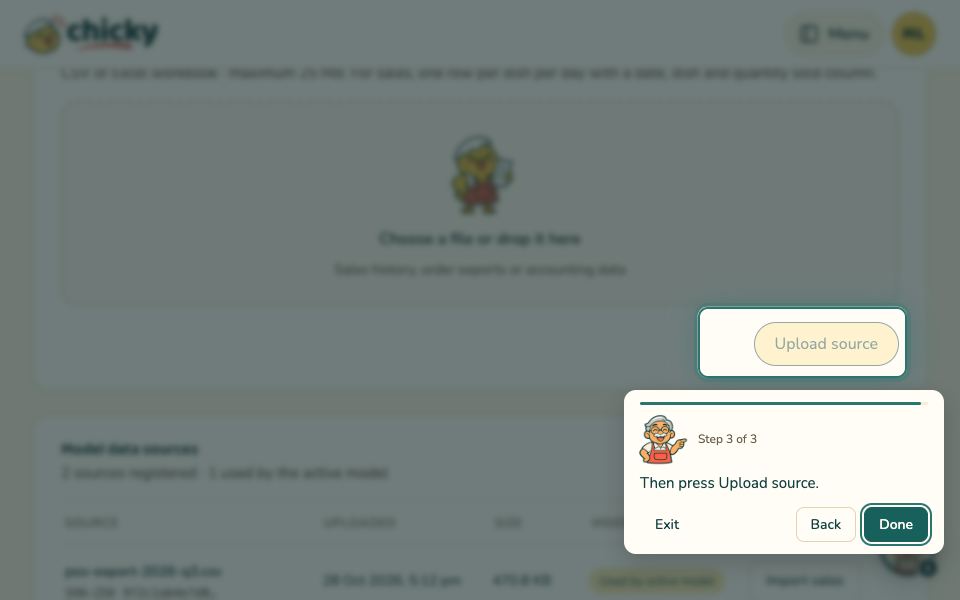 |

The spotlight is one shade with a rounded hole cut out by `clip-path`, redrawn each frame, so the
highlighted element stays clickable and nothing else is. The dim overlay never disappears or jumps
between steps, even across pages. Three pieces make that work, and each page needs all three:

1. `js/guide.js` saves the spotlight's position with the tour state when the page is hidden
   (`pagehide`), and draws it again as soon as the next page's `guide.js` runs.
2. Mid-tour, a one-line script in each page's `<head>` holds the first paint (a render-blocking
   `<link rel="expect" href="#guide-ready">`) until the `<span id="guide-ready" hidden>` placed right
   after `guide.js`. Without it, the browser shows the new page undimmed for a frame or two before
   the overlay is back.
3. A tour follows its link to the next page at once; the spotlight is saved on the way out and picked up there.

**Reduced motion.** With `prefers-reduced-motion`, every transition and animation in `base.css`
collapses to an instant change, and the tour jumps straight to each step. The sign-in page's animation is written inside
`@media (prefers-reduced-motion: no-preference)` and chart easing is checked in JS, so neither runs. Any new animation must
respect it too, and a local effect such as the "Record sales" fill shows its end state at once instead of growing.

## Phones

Stall owners use Chicky on a phone at the stall, often one-handed. Every page must work from 360px
wide in Safari, and `frontend/tests/phone-check.cjs` checks that the main flows do (see
[README.md](README.md)).

- **No sideways scrolling.** Layouts go to one column at 760px.
- **Tap targets are at least 44px.** On touch screens (`@media (pointer: coarse)`)
  `--control-height` becomes 44px, and the menu, avatar, segmented buttons and assistant buttons
  grow to match. When you add a control, check it under that media query.
- **Text in fields is at least 16px on touch screens.** iOS zooms the whole page in when you tap a
  field with smaller text. `.input`, `select` and `textarea` get this from `base.css`; a field with
  its own font size needs its own rule.
- **Respect the iPhone's notch and home bar.** Pages use `viewport-fit=cover`, and anything
  pinned to an edge (the header, the assistant button and panel, the page's bottom padding) adds
  `env(safe-area-inset-*)`.
- **Nothing pinned may cover a control at the bottom of the page.** The page's bottom padding keeps
  the last controls clear of the assistant button.
- **Tables reflow.** Below 600px the assistant's confirm card puts each dish on its own line, with
  its date, portions and remove button beneath, instead of squeezing four columns.

**Home-screen app.** `manifest.webmanifest`, the icons in `images/icons/` and the `apple-touch-icon`
link let people add Chicky to their home screen, where it opens full screen. Every page links them;
copy the block under "Home-screen app" in a page's `<head>` into new pages. The icons are built from
the logo by `design/render-icons.cjs` (see [Logo](#logo)).

## Interaction states

| State | Treatment |
| --- | --- |
| Hover | `--accent-tint` (yolk) background on light items; `--accent-hover` on accent fills |
| Selected | `--accent-soft` (yolk) background with ink text, or `aria-pressed="true"` on a segmented button |
| Focus | 2px `--accent` outline, 2px offset (global `:focus-visible` in `base.css`). Never remove it without a replacement |
| Disabled | 45% opacity, `cursor: not-allowed` |
| Error | `--error` text; `--error-soft` background only inside the assistant |

Drive state from ARIA attributes (`aria-pressed`, `aria-current`, `aria-expanded`) rather than
extra classes, so the look and the accessibility tree can't drift apart.

## Writing

- **Sentence case** for everything: titles, buttons, labels, menu items ("Generate forecast",
  "Actions needed", "Demand forecast").
- Use the user's words: "portions", "dishes", "sales". Avoid "items", "records" and "SKU".
- Format dates with `en-SG` (`30 Oct`, `Saturday, 31 Oct`).
- Use typographic characters: `…` not `...`, curly quotes “ ” and ’, middle dot `·` as a separator.
- Errors say what happened and what to do: "Couldn’t generate a forecast. Try again in a moment."

## Accessibility

- Every page has one `h1`, and headings don't skip levels.
- Icon-only buttons need an `aria-label`; decorative SVGs get `aria-hidden="true"`.
- Status text uses `role="status"` + `aria-live="polite"`.
- Keep text at 4.5:1 contrast or better (see [Colour](#colour)).
- Everything respects `prefers-reduced-motion` (see [Motion](#motion)).

## Checklist for new UI

1. Link `css/base.css` before the page stylesheet, load both fonts, and copy into the `<head>`: the
   viewport meta (with `viewport-fit=cover`), the tour
   paint-hold script and the home-screen app block. Put `<span id="guide-ready" hidden></span>`
   right after the `js/guide.js` script tag.
2. Use the page skeleton: `body.app-shell`, the skip link, the shared `.topbar` (copied from `dashboard.html`), `main.page#main-content`,
   `.page-heading`, Lenis in the `<head>`, and load `js/api.js` then `js/app-shell.js`.
3. Make it reachable: a top-level page goes in the sidebar on **every** page, in the same order; a
   subpage is linked from its parent and links back to it (see [Getting around](#getting-around)).
4. Reach for an existing component before writing CSS. Page CSS is layout only, with tokens for
   every colour, size, radius and shadow. Put content in cards that open with a `.headline`.
5. One primary button per view (`.primary-button`: it brings the fill with it); sentence-case labels. No entrance or ambient
   animation; feedback motion uses the motion tokens and respects reduced motion.
6. Forms follow [Forms](#forms): `<form>` + `submit`, a `.form-actions` row, the primary button
   disabled until it can run, and inline `.status-text` for feedback, never `alert()`.
7. Charts: load `js/chart-theme.js` and use its presets.
8. Add `data-guide-id` to anything the assistant should be able to point at, and describe it in
   `backend/src/main/resources/assistant/app-guide.json` (`AppGuideConsistencyTest` checks both).
9. Check it at 1280px and 360px wide, run `frontend/tests/phone-check.cjs` (add the page to it if
   it's part of a main flow), then regenerate the screenshots if the page appears here.

### Regenerating screenshots

Start the frontend (`node frontend/server.mjs`), then from the repo root:

```sh
npm install --prefix /tmp/chicky-pw playwright    # once, outside the repo
PW=/tmp/chicky-pw/node_modules/playwright node frontend/design/capture-screenshots.cjs
```

The script mocks the API, so no backend or login is needed.

## Known gaps

- The sign-in page's picture is drawn in HTML and SVG (a sample chart and two sample cards), not
  real data. Swap it for artwork or a real screenshot once there is a logo and brand imagery.
- Dashboard "Actions needed" items, the forecast "Ask about this forecast" card (disabled) and its
  "Local events" factor are placeholders that aren't connected yet. When they are, keep the
  components above.
- The dashboard chat box's attach and code buttons don't do anything yet.
